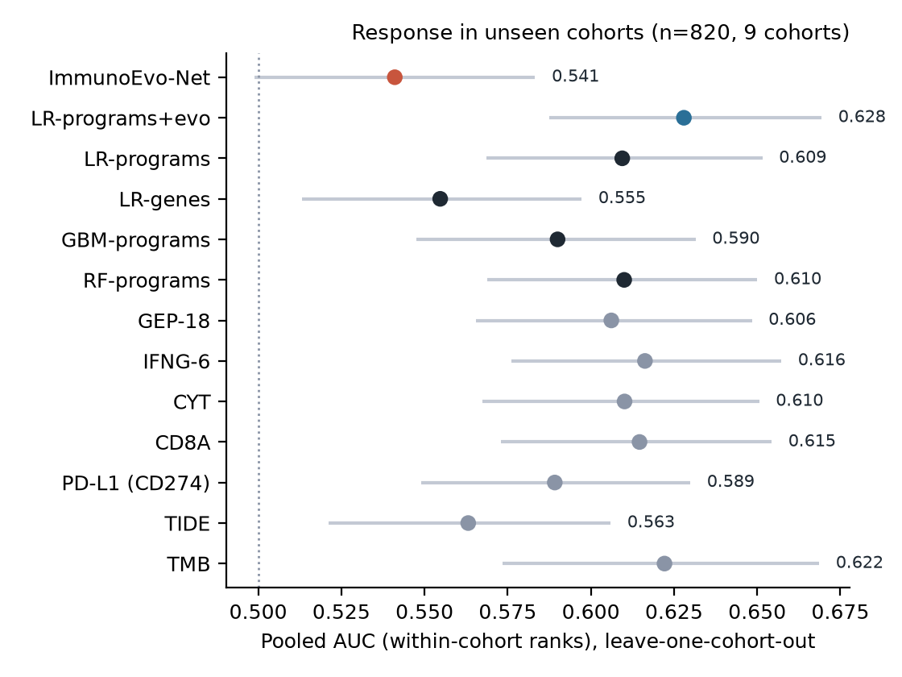

# ImmunoEvo-AI: Predicting Immunotherapy Response Across Cohorts, With Tumour Evolution

**Project 14 · Husain Naqvi · 2026** · computational immuno-oncology / tumour evolution · [findings write-up](docs/FINDINGS.md) · [figure gallery](https://engr-husainnaqvi.github.io/ImmunoEvo-AI/)

Only about one patient in three responds to immune-checkpoint blockade (ICB). Many published response signatures look strong in the cohort they were built in and then fail in the next one. This project asks three questions, using only public data:

1. **Transfer.** Does a model of tumour-microenvironment (TME) biology predict ICB response in a cohort, cancer type and drug it has **never seen**? Does a knowledge-guided deep network beat simple scores?
2. **Tumour evolution.** Do clonal-architecture features (intratumour heterogeneity via MATH, clonal fraction, clonal TMB), estimated from clinical sequencing panels, add anything beyond tumour mutational burden?
3. **Evolution on therapy.** In paired pre/on-treatment biopsies, which programmes change differently in responders and non-responders?

## Data (all public, via cBioPortal)

| Arm | Cohorts | Patients |
|---|---|---|
| RNA response | Riaz, Hugo, Liu, Gide (melanoma); IMmotion150, Choueiri (RCC); IMvigor210 (urothelial); Anders (TNBC); Prince (pancreatic) | **820 pre-treatment, 256 responders**, 20,890 genes |
| Evolution / survival | MSK-IMPACT ICB pan-cancer (training), Miao / Van Allen 2018 (mixed solid tumours; cBioPortal `mixed_allen_2018`), Rizvi 2018 (NSCLC; 211 MSK-overlapping patients removed) | 1,661 + 249 + 240 |
| On-treatment | paired biopsies in Riaz, Gide, Prince | 77 pairs |

## Headline results

**1. Leave-one-cohort-out (LOCO) response prediction.**
- *Evaluation:* each of the 9 cohorts is held out in turn; the models are trained on the other 8.
- *Metric:* pooled AUC on within-cohort ranks, with a cohort-stratified bootstrap.

| Model | Pooled LOCO AUC (95% CI) | Cohorts with AUC > 0.5 |
|---|---|---|
| **LR on 73 knowledge programmes + TMB/ITH (pre-specified)** | **0.628 (0.588–0.669)** | 8 / 9 |
| TMB alone (n = 587) | 0.622 | 7 / 8 |
| IFN-γ 6-gene score | 0.616 | 8 / 9 |
| CD8A | 0.615 | 7 / 9 |
| GEP-18 (Ayers 2017) | 0.606 | 8 / 9 |
| PD-L1 (CD274) mRNA | 0.589 | 8 / 9 |
| TIDE (published) | 0.563 | 7 / 9 |
| LR on 20,890 genes | 0.555 | 6 / 9 |
| **ImmunoEvo-Net (knowledge-masked deep net + cohort adversary)** | **0.541 (0.499–0.583)** | 5 / 9 |

- **The simple knowledge-programme model transfers best.** It beats TIDE (+0.064, p = 0.023), GEP-18 (+0.022, p = 0.027), PD-L1 (+0.038, p = 0.029), whole-transcriptome LR (+0.073, p < 0.001) and the deep network (+0.087, p < 0.001); all are paired cohort-stratified bootstraps.
- **It does not significantly beat the strongest single markers.** The gaps to CD8A (+0.013, p = 0.17), IFNG-6 (+0.012, p = 0.28) and TMB (+0.005, p = 0.89) are small and not significant. The ceiling for transferable response prediction from bulk RNA is low, around 0.62–0.63.
- **The deep model failed, and this is reported as a pre-specified negative result.** The network maps genes to 73 biological programmes through a knowledge-masked layer, uses a gradient-reversal cohort adversary, and adds evolution covariates. Its ablations (no adversary, no evolution, random programmes) all score 0.53–0.54.
  - Attribution analysis shows it learned **cohort and tissue confounders**: non-immune hallmarks such as KRAS-signalling-down, glycolysis and apical junction.
  - It was not renamed or retuned after these results were seen.
- **TMB/ITH features add a little:** +0.024 AUC for the programme model on the 587 patients with mutation data.

**2. Tumour evolution from clinical panels: an honest null beyond TMB.**
- In MSK pan-cancer (stratified Cox on OS), TMB is protective (HR 0.82 per SD). Clonal fraction (HR 0.95, p = 0.31) and MATH (HR 1.04, p = 0.35) are **not** independent of TMB.
- Cross-validated C-index (5×5 CV):

  | Model | C-index |
  |---|---|
  | Clinical only | 0.617 |
  | + TMB | 0.631 |
  | + evolution features | 0.633 |
  | DeepSurv | 0.631 |
  | RSF | 0.622 |

- **External validation.** For response, TMB gives AUC 0.647 (Allen) and 0.612 (Rizvi), and clonal TMB 0.637 and 0.578. MATH and clonal fraction are at or below 0.56.
- Panel-derived VAF purity correlates only modestly with pathology purity (Spearman 0.40, n = 1,025). This is one likely reason the clonality estimates are noisy.

**3. TME evolution on therapy.**
- Across 77 paired biopsies in 3 cohorts, responders show coordinated **falls** in tumour-intrinsic programmes compared with non-responders (Stouffer z, FDR < 0.05; same direction in all 3 cohorts):
  - mTORC1 (z = −4.1), melanocyte pigmentation (−3.6), glycolysis (−3.6), unfolded-protein response (−3.4), Hedgehog, protein secretion, mitotic spindle, DNA repair.
- This fits **tumour-cell clearance**. The T-cell and B-cell programmes rise in responders, but not significantly at this sample size.

## Repository

| Path | What |
|---|---|
| `src/ie.py` | data download, cohort harmonisation, MATH / VAF-purity / clonal features, 73 knowledge programmes, metrics |
| `src/models.py` | LOCO logistic / RF / GBM models; ImmunoEvo-Net (masked programme layer, gradient-reversal adversary) |
| `scripts/run_rna.py` | LOCO benchmark of 7 fixed scores and 9 trained models, plus attribution |
| `scripts/run_compare.py` | paired cohort-stratified bootstrap comparisons; TMB/ITH increment |
| `scripts/run_evo.py` | evolution arm: stratified Cox, RSF, DeepSurv, external cohorts |
| `scripts/run_ontx.py` | paired on-treatment programme changes (Mann–Whitney, then Stouffer and FDR) |
| `scripts/figures.py` | figures 1–6 |
| `results/` | all tables (CSV / JSON) behind the numbers above |

All computation ran on Google Colab (A100 runtime). Run the scripts in this order: `run_rna`, `run_evo`, `run_ontx`, `run_compare`, `figures`. Each script downloads its own data from cBioPortal on first use.

## Limitations
- The response labels (RECIST / clinical benefit) are harmonised by cBioPortal/iAtlas, and their definitions differ between cohorts.
- 2 of the 9 cohorts have fewer than 30 patients.
- Clonality estimated from targeted panels, without copy-number-aware CCF, is noisy. The null result applies to this setting, not to whole-exome phylogenetics.
- The on-treatment analysis has 77 pairs and covers bulk RNA only.

## Licence
Copyright © 2026 Husain Naqvi. **All Rights Reserved.** See [LICENSE](LICENSE). The third-party data are not redistributed.
